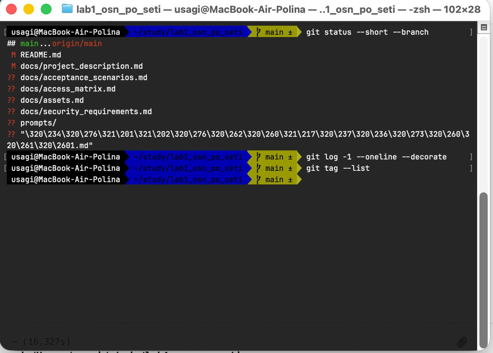
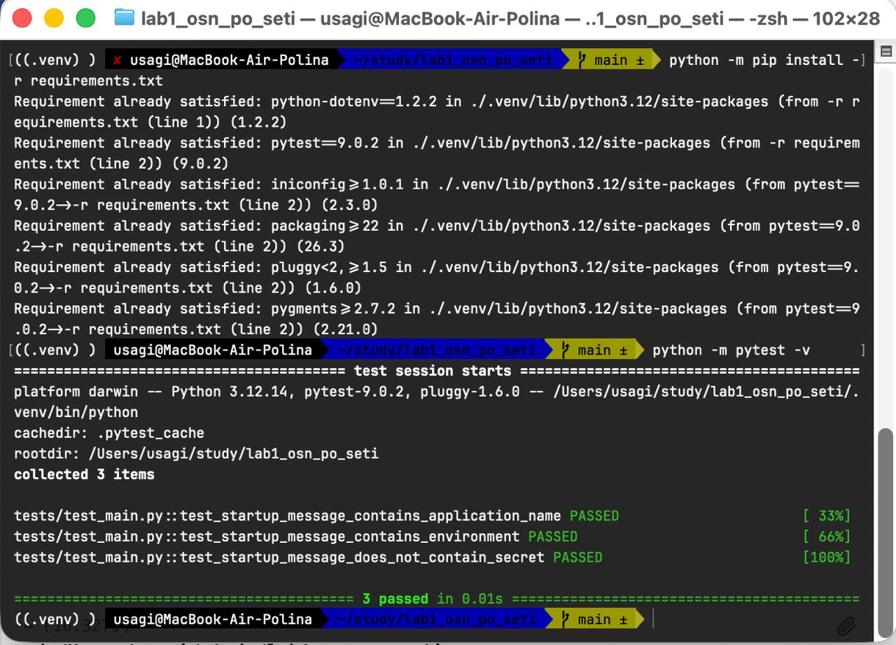
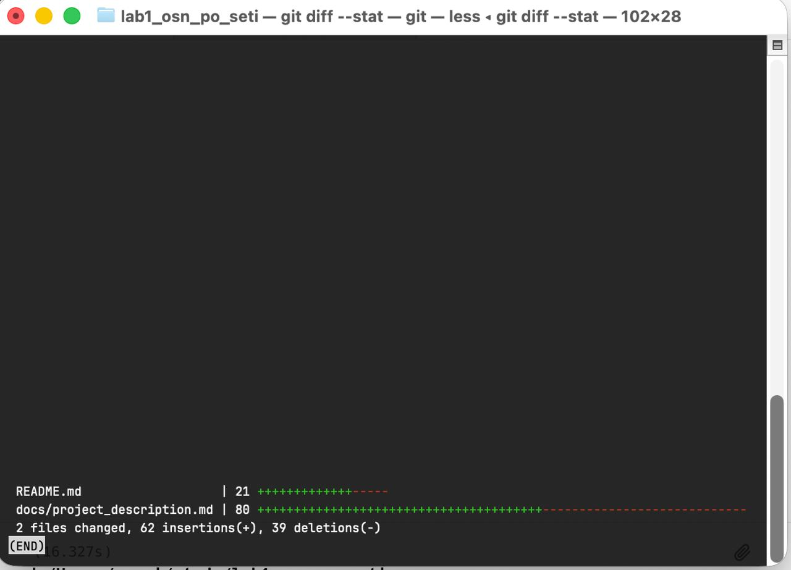
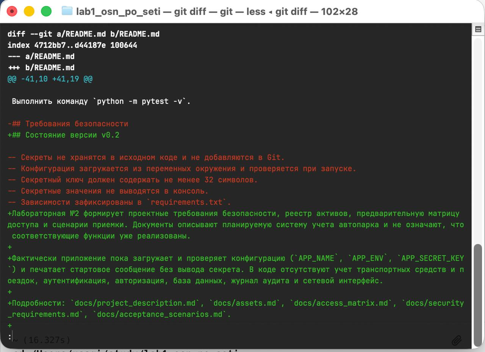
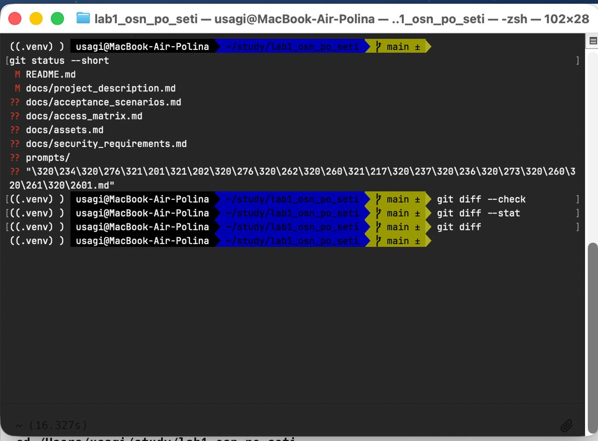
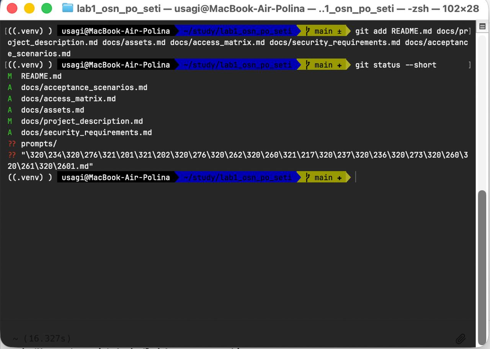
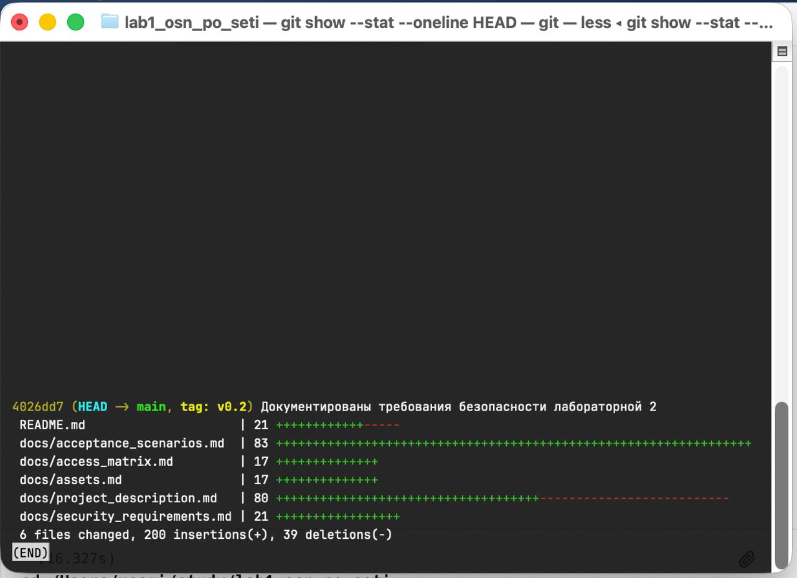
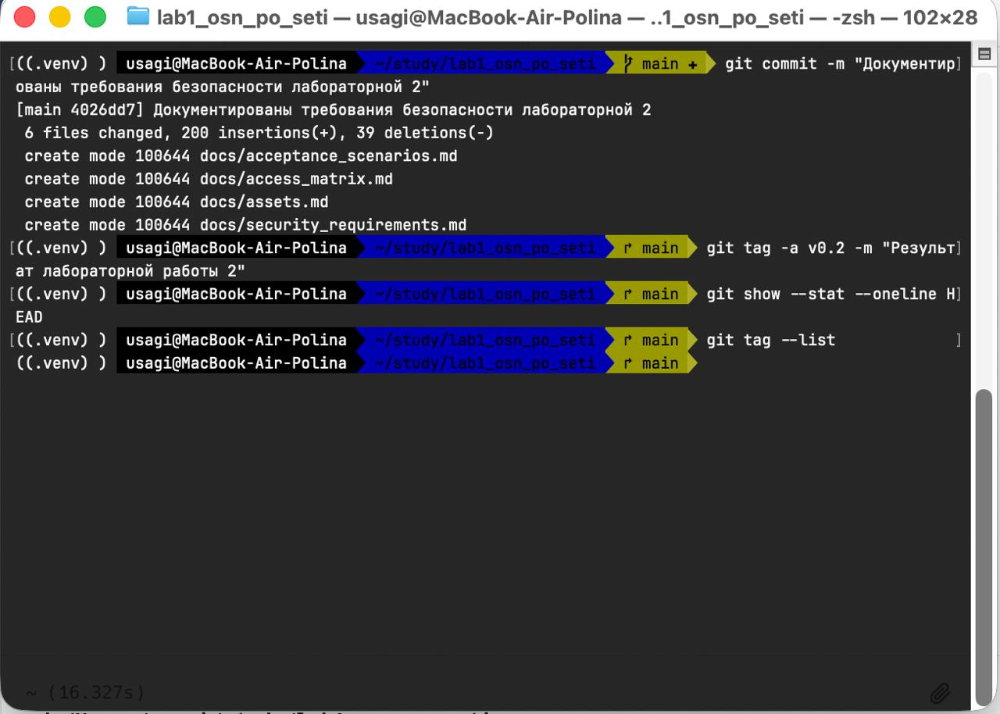
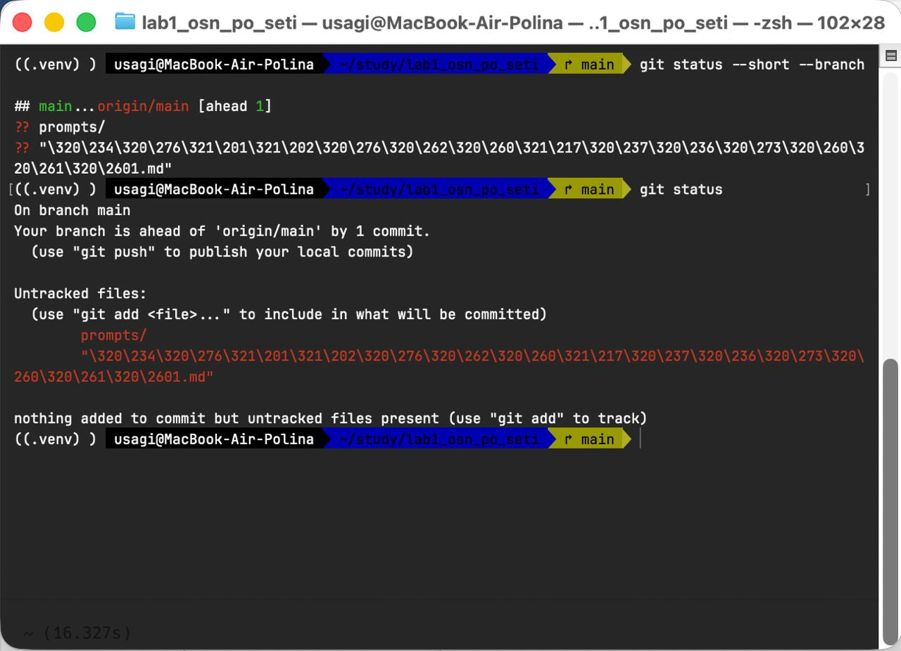
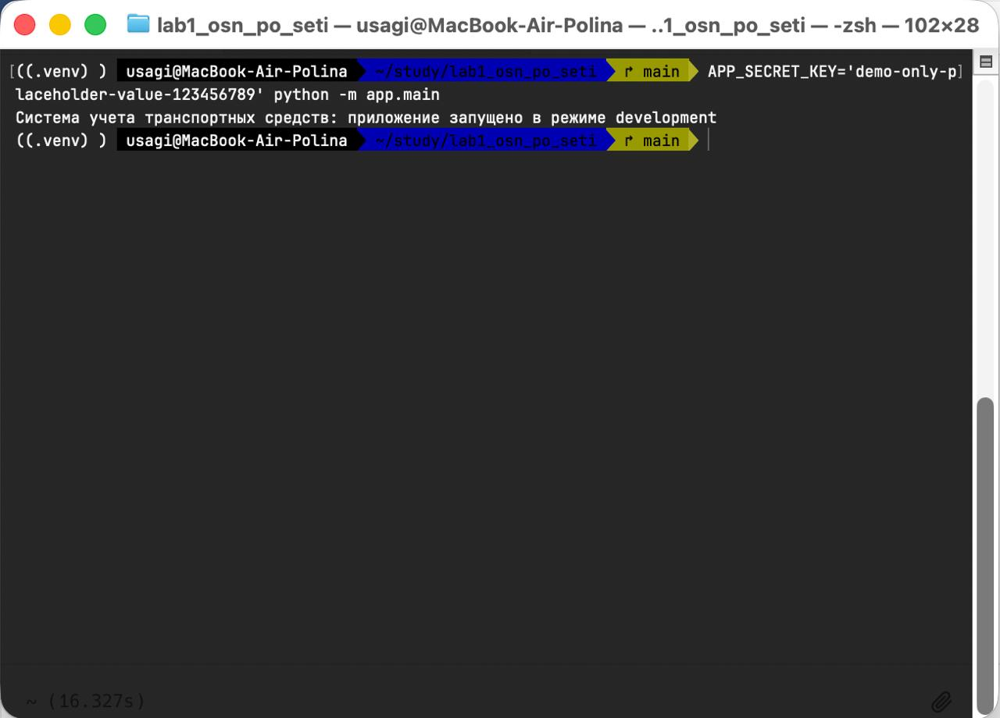

# Отчет по лабораторной работе № 2

| Параметр | Значение |
|---|---|
| Тема | Формирование требований безопасности к программной системе |
| Дисциплина | «Основы разработки защищенного программного обеспечения и компьютерных сетей» |
| Вариант | 19 — «Система учета транспортных средств организации» |
| Исходная версия | v0.1 |
| Версия лабораторной | v0.2 |
| Студент | Мостовая Полина Андреевна |
| Группа | ИУСбд-02-23 |

## 1. Цель работы

Цель работы — определить, какие данные и функции системы нужно защищать, кому они доступны и как проверять требования безопасности. Эта лабораторная продолжает проект, начатый в работе №1. Основной результат — документация; сами механизмы защиты будут разрабатываться позднее [1].

## 2. Назначение, границы и ограничения системы

Система учета транспортных средств организации предназначена для ведения реестра автопарка, закрепления транспорта за водителями, планирования поездок, учета пробега и контроля технического состояния. Она нужна, чтобы сведения об использовании служебного транспорта хранились и обновлялись в одном месте.

В границы проекта входят приложение, база данных, конфигурация и журнал событий. Кадровая система может быть источником профилей, но интеграция с ней в проект не входит. Система не управляет движением транспорта и не определяет его местоположение. Для проверок используются искусственные данные.

Сейчас приложение загружает и проверяет конфигурацию, затем выводит стартовое сообщение. Интерфейса, базы данных и учета транспорта и поездок пока нет; вход пользователей, разграничение доступа и журналирование также не реализованы.

### Роли

- **Водитель** просматривает только закрепленные ТС и собственные назначенные поездки, передает пробег и сведения о неисправностях.
- **Диспетчер** ведет карточки ТС, назначает транспорт, планирует поездки и учитывает состояние и обслуживание.
- **Руководитель** просматривает только агрегированные учетные отчеты, без деталей маршрутов.
- **Администратор** управляет учетными записями, ролями и настройками, просматривает журнал безопасности. Он не получает автоматического доступа к маршрутам и содержимому всех поездок.
- **Неаутентифицированный пользователь** может обратиться только к форме входа; данные и операции ему недоступны.

### Основные функции

В проекте описаны восемь будущих функций: вход, работа с карточками ТС, назначения и поездки, учет технического состояния, отчеты и журнал событий. Загрузка конфигурации (F-9) и вывод стартового сообщения (F-10) уже реализованы. Состав функций и их пользователи приведены в [описании проекта](docs/project_description.md).

### Категории обрабатываемых данных

Рассмотрены профили пользователей, учетные данные и роли, конфигурация, карточки ТС, назначения и поездки, техническое состояние, журналы и отчеты. Для каждой категории указаны примеры полей, источник, предполагаемое хранение и доступ. Подробная таблица находится в [реестре активов](docs/assets.md).

## 3. Реестр активов и оценка значимости

Для оценки использована шкала 1–3: 1 — низкая, 2 — средняя, 3 — высокая значимость. Для каждого актива определены `Ci`, `Ii`, `Ai`, ответственный и обоснование оценок. `Ki = max(Ci, Ii, Ai)` показывает наибольшую значимость из трех свойств; это не оценка риска.

В реестр вошли учетные записи, профили и роли, конфигурация, реестр ТС, поездки, сведения о техническом состоянии, журнал безопасности, отчеты, исходный код и доступность системы. Оценки и объяснения приведены в [реестре активов](docs/assets.md). Большинство этих активов относится к проектируемой системе; сейчас в проекте фактически есть только код и настройки приложения.

## 4. Предварительная матрица доступа

Политика основана на принципе минимальных привилегий и проверке полномочий для каждого запроса [3].

В матрице указаны права четырех ролей и неаутентифицированного пользователя для десяти операций. Для водителя доступ зависит от того, назначена ли ему поездка или транспортное средство. Руководитель видит только сводные отчеты; администратор не получает автоматический доступ ко всем поездкам. Не разрешенные явно действия запрещены. Матрица описывает планируемые правила, в коде они пока не реализованы. Полная таблица приведена в [матрице доступа](docs/access_matrix.md).

## 5. Требования безопасности

Сформулировано 13 требований: восемь функциональных, три нефункциональных и два процессных. У каждого есть идентификатор, тип, формулировка, связанные активы, обоснование, приоритет, критерий приемки, способ проверки и статус. Таблица находится в [спецификации требований](docs/security_requirements.md).

SEC-1–SEC-8 описывают доступ, роли, принадлежность поездки, изменение карточек и назначений, проверку отчета, аудит. SEC-9–SEC-11 описывают отсутствие секрета в выводе, проверку конфигурации и будущую защиту сетевой передачи. SEC-12 и SEC-13 относятся к процессу разработки и хранению секретов.

В коде проверяются имя приложения, режим работы и минимальная длина ключа конфигурации. Стартовое сообщение не содержит ключ. Отдельных автотестов ошибочных значений конфигурации пока нет. Остальные описанные механизмы безопасности еще не реализованы.

## 6. Приемочные сценарии

Подготовлены три пары позитивных и негативных сценариев. В каждом указаны начальные условия, тестовые данные, шаги, ожидаемый ответ, состояние данных и статус:

1. AT-1/AT-2 — анонимный запрос отклоняется; пользователь с действительными учетными данными проходит вход.
2. AT-3/AT-4 — водитель читает собственную назначенную поездку; запрос чужой поездки отклоняется без раскрытия и изменения записи.
3. AT-5/AT-6 — корректный отчет с пробегом принимается; пробег ниже исходного отклоняется без создания/изменения отчета.

Сценарии пока не выполнялись: функции учета и авторизации еще не реализованы. Связь активов, функций, требований и проверок показана в [документе сценариев](docs/acceptance_scenarios.md).

## 7. Проверка согласованности

В документах использована единая шкала активов, а категории данных связаны с их источниками и ограничениями доступа. Матрица соответствует ролям из описания системы; полномочия ограничены по принадлежности поездки или ТС. Сценарии связаны с требованиями, а статусы не выдают запланированное за уже реализованное.

Результат проверки:

- 4 аутентифицированные роли и неаутентифицированный пользователь описаны и отражены в матрице;
- 10 функций (больше требуемых пяти) и 7 категорий данных (больше пяти) перечислены;
- реестр содержит 10 активов с оценками по учебной шкале и обоснованиями;
- матрица имеет 10 операций, все ячейки определены;
- требования имеют все обязательные поля, ссылки ведут на существующие активы;
- 6 подробных сценариев распределены поровну на позитивные и негативные и не объявлены выполненными;
- данные функций, активов, требований и сценариев связаны таблицей прослеживаемости;
- будущее и фактическое состояние разделены;
- документы не содержат реальных учетных данных.

## 8. Проверки кода и Git

В тестовом наборе три проверки стартового сообщения. Команда `.venv/bin/python -m pytest -v` завершилась результатом **3 passed**. Тесты проверяют текст сообщения и то, что в нем нет секрета. Будущие функции учета они не проверяют.

Основной результат лабораторной зафиксирован тегом `v0.2` на commit `4026dd7`. После дополнительной сверки документы уточнены в commit `93f0769`, для него создан тег `v0.2.1`; существующий тег `v0.2` не перемещался. Commit и оба тега отправлены в удаленный репозиторий. Сейчас `origin/main` указывает на `93f0769`, `v0.2` — на исходный commit лабораторной, `v0.2.1` — на commit с уточнениями. Отчет и снимки находятся отдельно от проектных файлов.

## 9. Контрольные вопросы

1. **Зачем задают границы системы?** Чтобы определить, какие компоненты и процессы защищаются проектом, а какие относятся к внешним системам и их владельцам.
2. **Чем актив отличается от категории данных?** Категория группирует похожие данные; актив — объект или ресурс, ценность которого требует защиты. Один актив может включать несколько категорий.
3. **Какие последствия относятся к C/I/A?** Конфиденциальность — раскрытие; целостность — подмена или уничтожение; доступность — невозможность использовать ресурс вовремя.
4. **Почему значимость актива — не риск?** Значимость показывает ущерб при потере свойства; риск дополнительно учитывает угрозу, сценарий и вероятность реализации.
5. **Что теряется в `Ki=max(Ci,Ii,Ai)`?** Показатель скрывает два остальных значения и различия профиля свойств; поэтому рядом приводятся все три оценки и их обоснования.
6. **Чем роль отличается от учетной записи?** Роль — набор полномочий; учетная запись представляет конкретного пользователя, которому назначают роль.
7. **Почему важна принадлежность объекта?** Одной роли может быть недостаточно: водитель должен видеть только назначенные ему поездки, а не все поездки класса объектов.
8. **Должен ли администратор автоматически видеть все данные?** Нет. Ему предоставляются только полномочия, необходимые для административной задачи; доступ к прикладным маршрутам отдельно обосновывается.
9. **Функциональное и нефункциональное требование?** Функциональное задает защитное действие системы; нефункциональное — измеримое свойство или ограничение ее работы.
10. **Зачем процессные требования?** Они закрепляют безопасные правила разработки и сопровождения, например ревью изменений и тестирование контроля доступа.
11. **Что делает требование проверяемым?** Однозначное действие, условия, наблюдаемый критерий и описанный способ проверки.
12. **Критерий приемки и способ проверки?** Критерий говорит, какой результат должен наблюдаться; способ проверки — как получить и проверить этот результат.
13. **Зачем уникальный ID?** Чтобы однозначно ссылаться на требование из сценариев, таблиц, ревью и дальнейших документов.
14. **Как связаны активы, функции, требования и тесты?** Функция использует актив; требование ограничивает защитное поведение функции; тест проверяет выполнение критерия требования на соответствующих активах.
15. **Позитивный и негативный сценарий?** Позитивный проверяет разрешенное действие; негативный — отказ запрещенного действия или обработку неправильных данных.
16. **Зачем при отказе проверять состояние данных?** Отказ в ответе недостаточен, если операция успела изменить данные; проверка подтверждает отсутствие побочного изменения.
17. **Почему длина секрета не гарантирует непредсказуемость?** Длинное значение может быть предсказуемым. Нужны достаточная случайность, безопасная генерация, хранение и применение.
18. **Чем отличаются статусы?** «Сформулировано» фиксирует требование; «реализовано» означает наличие механизма; «проверено» требует фактической проверки с результатом.
19. **Что проверить до commit?** Состав staged файлов, diff, отсутствие секретов и временных/локальных материалов, согласованность документации и результаты применимых тестов.
20. **Как работа используется для модели угроз?** Активы, роли, границы, требования и сценарии дают основу для определения нарушителей, угроз, последствий и оценки рисков в лабораторной №3.

## 10. Вывод

Подготовлена спецификация безопасности для варианта 19 «Система учета транспортных средств организации». Описаны границы системы, пользователи, функции, категории данных, активы и их значимость, предварительные полномочия, требования и сценарии приемки. Текущая реализация остается минимальной: запуск и проверка конфигурации; функции учета и авторизации не реализованы. Исходные автоматические тесты прошли, но сценарии приемки будущих функций пока не выполнялись. Уточнения к документации зафиксированы в commit `93f0769` и опубликованы под тегом `v0.2.1`; исходный тег `v0.2` сохранен.

## Список использованных источников

1. Методические указания «Лабораторная работа № 2. Формирование требований безопасности к программной системе».
2. OWASP Foundation. Application Security Verification Standard (ASVS), version 5.0.0 [Электронный ресурс]. URL: <https://owasp.org/www-project-application-security-verification-standard/> (дата обращения: 15.10.2026).
3. OWASP Foundation. Authorization Cheat Sheet [Электронный ресурс]. URL: <https://cheatsheetseries.owasp.org/cheatsheets/Authorization_Cheat_Sheet.html> (дата обращения: 15.10.2026).

## Приложение А. Скриншоты хода работы и проверок

На снимках показаны исходное состояние проекта, выполнение тестов, просмотр изменений, фиксация версии и запуск приложения. Они не подтверждают выполнение сценариев приемки будущих функций.

### Скриншот 1. Исходное состояние репозитория

### Скриншот 2. Установка зависимостей и выполнение трех исходных тестов

### Скриншот 3. Сводка diff после первоначального обновления README и описания

### Скриншот 4. Фрагмент diff README с отделением реализованного от запланированного

### Скриншот 5. Проверка статуса, diff и whitespace

### Скриншот 6. Staging документов ЛР №2

### Скриншот 7. Сводка commit и тега v0.2

### Скриншот 8. Создание commit и тега v0.2

### Скриншот 9. Git status после commit

### Скриншот 10. Запуск приложения

