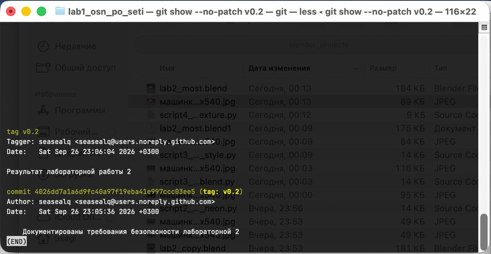
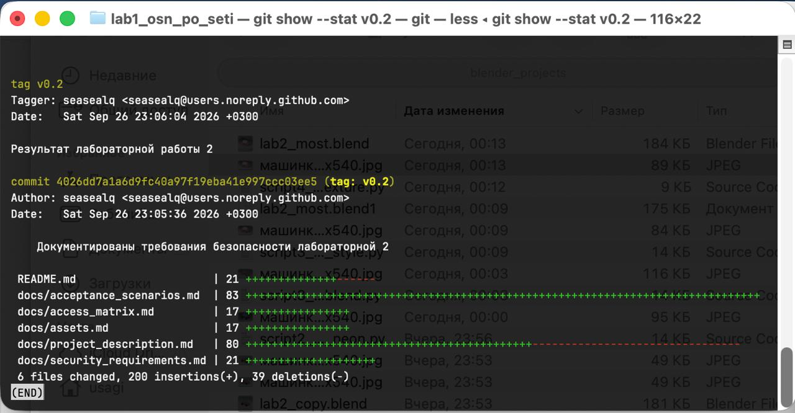
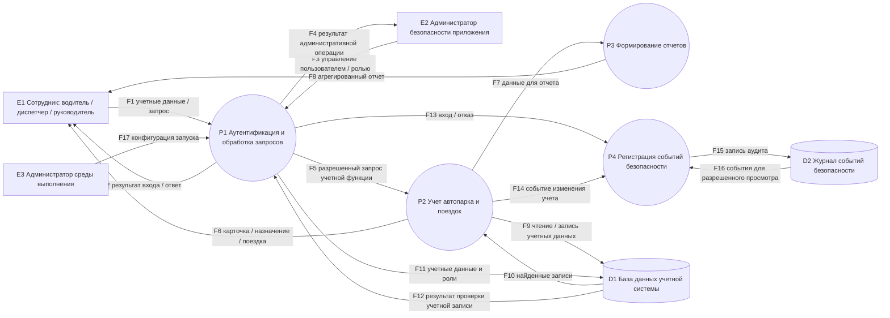
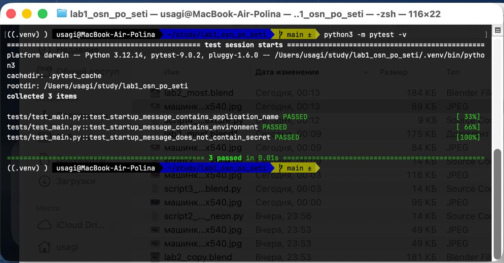
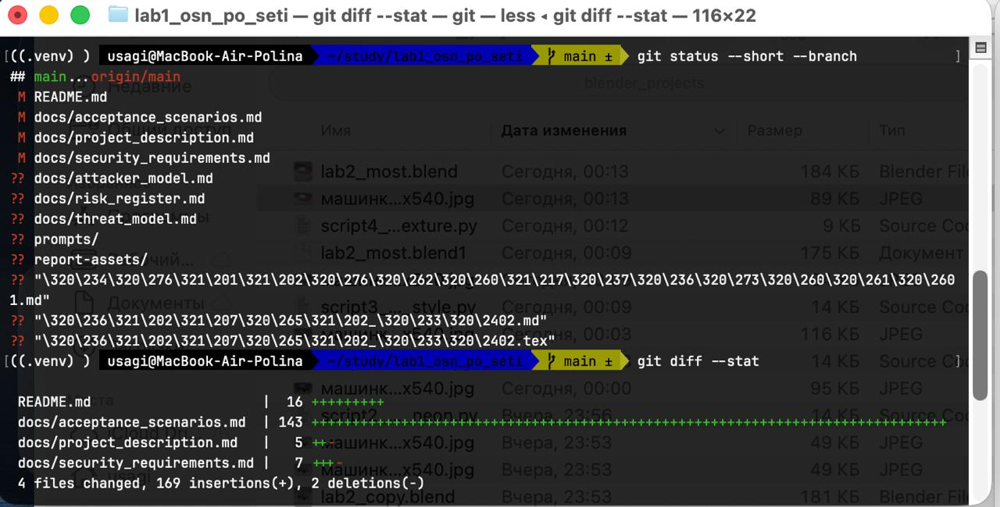
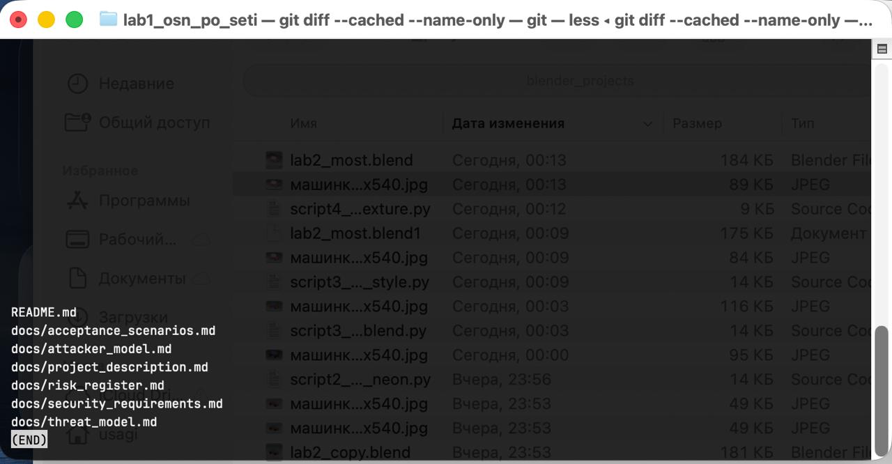
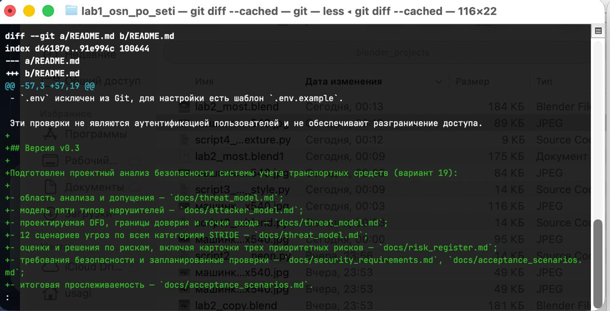
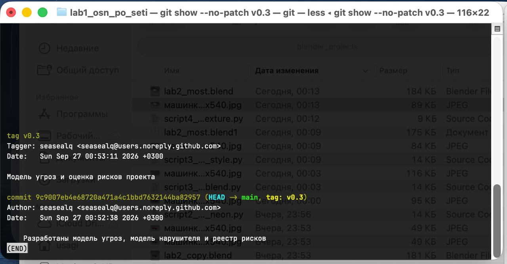
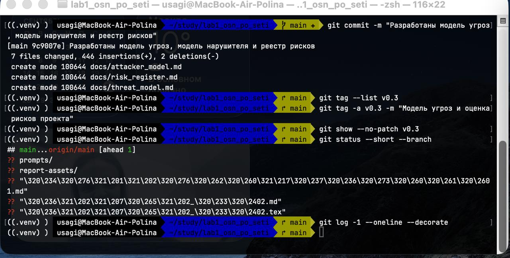

# Отчет по лабораторной работе № 3

| Параметр | Значение |
|---|---|
| Тема | Разработка модели угроз и модели нарушителя программной системы |
| Дисциплина | «Основы разработки защищенного программного обеспечения и компьютерных сетей» |
| Вариант | 19 — «Система учета транспортных средств организации» |
| Исходная версия | v0.2 |
| Версия лабораторной | v0.3 |
| Студент | Мостовая Полина Андреевна |
| Группа | ИУСбд-02-23 |
**Дата:** 28 сентября 2026 г.

## 1. Цель работы

Цель работы — освоить выявление угроз программной системе, описание возможностей и ограничений нарушителей, построение диаграммы потоков данных, предварительную оценку рисков и обоснование защитных мер. В работе модель угроз связана с конкретными функциями и активами системы учета транспорта.

## 2. Исходное состояние и предметная область

Сквозной проект — система учета транспортных средств организации. Она предназначена для ведения реестра автопарка, закрепления транспорта за водителями, планирования поездок, учета пробега и контроля технического состояния.

Исходный лабораторный тег `v0.2` указывает на commit `4026dd7`. Документация предыдущего этапа описывает активы AS-1–AS-10, роли и предварительную матрицу доступа, SEC-1–SEC-13 и приемочные сценарии AT-1–AT-6. Основная часть пользовательских функций и защитных механизмов в коде пока не реализована.

Фактически приложение загружает настройки из переменных окружения и `.env`, проверяет имя приложения, режим работы и минимальную длину `APP_SECRET_KEY`, после чего печатает стартовое сообщение без значения секрета. Сетевого интерфейса, аутентификации и авторизации, базы данных, функций учета ТС и поездок, а также журнала аудита нет. В проверенном тестовом наборе находятся три теста стартового сообщения.

Проектируемое состояние включает пользовательский интерфейс, процессы аутентификации и учета, базу данных учетных записей и транспортных данных, отчетность и журналирование. Эти элементы отмечены как планируемые. Сценарий угрозы не является доказательством уязвимости работающего приложения, а наличие требования не подтверждает его выполнение.

*Рисунок 1 — Просмотр метки v0.2 и исходного commit.*

*Рисунок 2 — Состав результатов лабораторной работы № 2.*

## 3. Область анализа, допущения и ограничения

В анализ включены вход пользователей, просмотр и ведение карточек ТС, назначение транспорта, планирование и отчетность по поездкам, техническое состояние, управление доступом и регистрация значимых действий. Рассматриваются сотрудники, администратор приложения, администратор среды выполнения, процессы приложения и планируемые хранилища.

Не рассматриваются интеграция с кадровой системой, бухгалтерский учет, телематика, фактическое местоположение и физическое управление транспортом. В тестовых сценариях используются искусственные сведения.

| ID | Допущение | Что изменится, если допущение неверно | Состояние защиты |
|---|---|---|---|
| ASM-01 | Клиент обращается к приложению; прямой доступ рабочего места к базе данных не предоставляется | Понадобится отдельный анализ сетевого доступа к СУБД | Требует проверки на развертывании; интерфейса сейчас нет |
| ASM-02 | Пользовательские запросы и идентификаторы, пришедшие от клиента, считаются недоверенными | Возникнет необоснованное доверие к клиентским параметрам и выше станет риск подмены владельца/назначения | Серверная проверка предусмотрена, но не реализована |
| ASM-03 | Учетная запись приложения для БД имеет только необходимые права | Компрометация процесса сможет затронуть больше записей и операций | Требует проверки после выбора СУБД |
| ASM-04 | В учебной среде используются искусственные профили, поездки и сведения автопарка | Реальные данные потребуют повторной оценки последствий и пересмотра доступа/хранения | Искусственные примеры применяются в документации; эксплуатация с реальными данными не подтверждена |
| ASM-05 | Журнал аудита логически отделен от учетных записей, а доступ к нему ограничен | Изменение учетных данных может одновременно позволить скрыть историю действий | Требует проверки; физическая отдельность хранилища не определена |
| ASM-06 | Критические изменения назначения, состояния ТС и ролей должны связываться с субъектом и результатом | Станет трудно расследовать фиктивную выдачу/возврат и административные изменения | Требование сформулировано; реализация и защита журнала требуют проверки |

Модель является проектным анализом. Она не включает тестирование на проникновение и не подтверждает наличие дефектов в ещё не реализованных компонентах.

## 4. Модель нарушителя

Для каждого типа зафиксированы положение относительно системы, исходный доступ, знания, возможности, цели и ограничения.

| ID | Тип и исходный доступ | Возможности и цель | Отсутствующие права и ограничения |
|---|---|---|---|
| N-01 | Внешнее лицо без учетной записи; сейчас публичного интерфейса нет | В проектируемом интерфейсе может отправлять и повторять запросы; цель — получить доступ к сведениям автопарка или нарушить доступность входа | Не имеет учетной записи, доступа к БД и серверу; планируемые ограничения — аутентификация, лимиты и запрет прямого доступа к БД |
| N-02 | Водитель с собственной учетной записью, если вход будет реализован | Использует разрешенные функции, меняет параметры собственных запросов; может пытаться прочитать чужую поездку или подменить свой отчет | Не имеет прав диспетчера, администратора и ОС; серверная проверка каждой записи пока запланирована |
| N-03 | Диспетчер с прикладной учетной записью | Ведет записи автопарка и назначения; возможная цель — неправомерно изменить историю выдачи/возврата либо сведения о ТС | Не получает права управлять ролями, ОС или СУБД; разделение полномочий и аудит пока проектируются |
| N-04 | Администратор безопасности приложения | Управляет учетными записями и ролями в пределах прикладных прав; может пытаться скрыть свое административное действие | Не получает автоматически прав ОС, процесса приложения или БД; необходимы аудит и ограничение прикладных полномочий |
| N-05 | Администратор среды выполнения (ОС) | Имеет локальный доступ к файлам/процессу в рамках ОС; потенциально может читать конфигурацию или остановить процесс | Не считается автоматически администратором приложения или СУБД; разделение системных учетных записей запланировано |

Администратор приложения и администратор ОС рассматриваются раздельно, так как их полномочия находятся на разных уровнях.

## 5. Диаграмма потоков данных

Диаграмма описывает логические потоки проектируемой системы, а не физическую схему сети. Все пользовательские функции и хранилища ниже запланированы, кроме локальной загрузки конфигурации.

| ID | Назначение и состояние |
|---|---|
| E1 | Сотрудник — водитель, диспетчер или руководитель; внешняя сущность, роли проектируются |
| E2 | Администратор безопасности приложения; внешняя сущность проектируемых функций управления |
| E3 | Администратор среды выполнения; локальная загрузка конфигурации реализована, администрирование будущего сервера не проектировалось |
| P1 | Аутентификация и обработка клиентских запросов; проектируется |
| P2 | Учет карточек ТС, назначений, поездок и технического состояния; проектируется |
| P3 | Подготовка отчетов; проектируется |
| P4 | Формирование/прием событий аудита; проектируется |
| D1 | База учетной системы: профили, роли, карточки, поездки и состояние; проектируется |
| D2 | Логическое хранилище событий безопасности; проектируется, физическая отдельность не подтверждена |
| F1 | Учетные данные и пользовательский запрос от E1 к P1; проектируется |
| F2 | Результат входа или разрешенный ответ от P1 к E1; проектируется |
| F3 | Команда управления пользователем/ролью от E2 к P1; проектируется |
| F4 | Результат административной операции от P1 к E2; проектируется |
| F5 | Разрешенный запрос учетной функции от P1 к P2; проектируется |
| F6 | Карточка ТС, назначение, поездка или состояние от P2 к E1; проектируется |
| F7 | Подготовленные данные учета от P2 к P3; проектируется |
| F8 | Агрегированный отчет от P3 к E1; проектируется |
| F9 | Чтение/запись учетных данных от P2 к D1; проектируется |
| F10 | Найденные учетные записи от D1 к P2; проектируется |
| F11 | Учетные данные и роли от P1 к D1; проектируется |
| F12 | Результат проверки учетной записи от D1 к P1; проектируется |
| F13 | Событие входа/отказа от P1 к P4; проектируется |
| F14 | Событие изменения учета от P2 к P4; проектируется |
| F15 | Запись аудита от P4 к D2; проектируется |
| F16 | События для разрешенного просмотра от D2 к P4; проектируется |
| F17 | Конфигурация запуска от E3 к P1; локальная загрузка реализована, связь с будущим сервером проектируется |

### Границы доверия

| ID | Что разделяет | Потоки | Проверки на границе |
|---|---|---|---|
| TB-01 | Клиентские участники и приложение | F1–F6, F8 | Аутентификация, серверная проверка роли и прав на конкретную запись, валидация полей/размера, минимизация ответа |
| TB-02 | Процессы приложения и D1 | F9–F12 | Ограниченные права учетной записи БД, параметризованные запросы, запрет прямого доступа клиентов |
| TB-03 | Процессы приложения и хранилище аудита | F13–F16 | Проверка источника/схемы события, ограничение чтения и изменения, политика объема/хранения и реакция на заполнение |

Граница доверия может проходить между процессами и учетными записями на одном сервере: её смысл связан с полномочиями и проверками, а не только с физической сетью.

### Точки входа

| Точка входа | Данные и источник | Необходимые проверки | Статус |
|---|---|---|---|
| Форма входа | Идентификатор и пароль от N-01/сотрудника | Проверка учетной записи, ограничение попыток, безопасный ответ, отсутствие секрета в логах | Проектируется |
| Чтение карточки или поездки | ID записи от водителя/диспетчера | Серверная проверка права на конкретную запись и минимизация выдаваемых полей | Проектируется |
| Изменение карточки ТС | Поля автомобиля и статус от диспетчера | Формат, допустимые поля и переходы статуса, серверная роль | Проектируется |
| Назначение, выдача/возврат | ID ТС, водителя, поездки, даты и статус | Существование объектов, отсутствие конфликтующего назначения, фиксация истории | Проектируется |
| Отчет о поездке | Пробег, ID поездки и сведения о неисправности от водителя | Принадлежность поездки, диапазон пробега, размер и формат текста | Проектируется |
| Управление ролями | Пользователь и новая роль от N-04 | Полномочия исполнителя и аудит прежнего/нового значения | Проектируется |
| Запрос отчета | Период и параметры от диспетчера/руководителя | Ролевой доступ и агрегация без раскрытия маршрутов руководителю | Проектируется |
| Загрузка конфигурации | APP_NAME, APP_ENV, APP_SECRET_KEY от среды запуска | Допустимая среда, непустое имя, длина ключа, отсутствие ключа в выводе | Частично реализовано для текущего запуска |
| Прием события аудита | Субъект, действие, объект, время, результат от P1/P2 | Доверенный источник, схема события, объем и защита целостности | Проектируется |

## 6. Анализ угроз STRIDE

Основная категория указана для каждого сценария. Ни один из сценариев ниже не объявляется обнаруженной уязвимостью.

| ID | Категория | Сценарий, нарушитель и активы | Связи и статус |
|---|---|---|---|
| TH-01 | S — Spoofing | N-01 подбирает учетные данные через будущую форму входа, если не ограничены повторные попытки; возможны действия от имени сотрудника. AS-1, AS-2. | P1, D1; F1, F11–F12; TB-01/TB-02; SEC-1, SEC-14. Проектное предположение. |
| TH-02 | S — Spoofing | N-02 использует чужой действующий сеанс при недостаточно определенных правилах отзыва, что приводит к операциям, приписанным другому водителю. AS-1, AS-5. | P1; F2/F5; TB-01; SEC-1, SEC-14. Проектное предположение. |
| TH-03 | T — Tampering | N-03 меняет ответственного или фиксирует фиктивную выдачу/возврат при отсутствии серверной проверки перехода; история поездок становится недостоверной. AS-2, AS-5. | P2, D1; F5–F6, F9; TB-01/TB-02; SEC-2, SEC-5, SEC-15. Проектное предположение. |
| TH-04 | T — Tampering | N-03 изменяет карточку ТС или состояние обслуживания при недостаточной проверке полей/статусов; учет требует сверки и исправления. AS-4, AS-6. | P2, D1; F5, F9–F10; TB-01/TB-02; SEC-2, SEC-4, SEC-7. Проектное предположение. |
| TH-05 | T — Tampering | N-02 подменяет пробег или ID поездки при отсутствии серверной проверки принадлежности и допустимого значения; искажается отчет. AS-5. | P2, D1; F1, F5–F6, F9; TB-01/TB-02; SEC-2, SEC-6. Проектное предположение. |
| TH-06 | E — Elevation of Privilege | N-02 меняет запрос управления ролью, если проверка выполняется только в интерфейсе; это может открыть функции диспетчера/администратора. AS-2. | P1, D1; F3–F4, F11–F12; TB-01/TB-02; SEC-2, SEC-14. Проектное предположение. |
| TH-07 | R — Repudiation | N-04 меняет роль и оспаривает действие, если журнал не фиксирует исполнителя и прежнее/новое значение. AS-2, AS-7. | P1, P4, D2; F3–F4, F13, F15; TB-01/TB-03; SEC-7, SEC-16. Проектное предположение. |
| TH-08 | I — Information Disclosure | N-02 подменяет ID поездки и читает чужой маршрут при отсутствии проверки доступа к объекту. AS-5, AS-8. | P1–P3, D1; F1–F2, F5–F8, F9–F10; TB-01/TB-02; SEC-2, SEC-3. Проектное предположение. |
| TH-09 | I — Information Disclosure | N-05 или субъект с доступом к диагностике получает `APP_SECRET_KEY`, если ошибочный вывод содержит конфигурацию. AS-3. | P1; F17, F1–F2; TB-01; SEC-9, SEC-10. Требует проверки; фактическая утечка не подтверждена. |
| TH-10 | D — Denial of Service | N-01 посылает чрезмерно крупные или частые запросы при отсутствии лимитов, из-за чего функции учета становятся недоступны. AS-10. | P1/P2; F1, F5; TB-01; SEC-18. Проектное предположение. |
| TH-11 | D — Denial of Service | N-03/N-05 вызывает большой поток событий или использует отсутствие политики хранения, что может заполнить D2 и повлиять на аудит/доступность. AS-7, AS-10. | P4, D2; F13–F15; TB-03; SEC-7, SEC-16. Проектное предположение. |
| TH-12 | E — Elevation of Privilege; T — Tampering | N-05 использует чрезмерные права учетной записи БД после компрометации процесса и меняет учетные записи либо историю ТС/поездок. AS-4, AS-5, AS-7. | P2, D1; F9–F10; TB-02; SEC-2, SEC-17. Проектное предположение. |

Рассмотрены все категории STRIDE: S — TH-01/02; T — TH-03/04/05/12; R — TH-07; I — TH-08/09; D — TH-10/11; E — TH-06/12. Категория STRIDE группирует сценарий, но не заменяет оценку его вероятности и последствий [2, 3].

## 7. Оценка и обработка рисков

Применена учебная шкала методички [1]; руководство NIST SP 800-30 рассматривает оценку рисков как отдельный процесс [4]: `L` — вероятность от 1 (низкая) до 3 (высокая); `S` — последствия от 1 (незначительные) до 3 (критические); `R = L × S`. Приоритеты: 1–2 низкий, 3–4 средний, 6–9 высокий. Баллы — экспертное учебное ранжирование, не вероятности в процентах и не денежный ущерб. Оценки Ci/Ii/Ai активов использованы как контекст, но не перенесены в S автоматически. Запланированные меры не снижали исходный риск.

| Риск | Оценка и обоснование | Приоритет и обработка |
|---|---|---|
| RS-01 / TH-01 | **L=3:** будущая форма доступна клиентам; без ограничения попыток повторы не требуют специального доступа. **S=2:** полученная учетная запись дает права одной роли, но не администратора автоматически; возможны чтение/изменение разрешенных ей данных. Неопределенность высокая: вход и лимиты не реализованы. **R=6.** | Высокий. Снизить проверкой учетной записи и серверным ограничением попыток; ответственный — разработчик аутентификации; до допуска формы входа, v0.4. |
| RS-02 / TH-02 | **L=1:** требуется получить действующий чужой сеанс или доступ к устройству; сеансов пока нет. **S=2:** возможно действие в рамках прав одного водителя и искажение атрибуции ограниченной группы поездок. Неопределенность высокая: правила сеанса не выбраны. **R=2.** | Низкий. Снизить правилами срока и отзыва сеанса; разработчик входа, v0.4. |
| RS-03 / TH-03 | **L=2:** нужен диспетчерский доступ и отсутствие серверной проверки перехода; оба условия реалистичны для будущей функции. **S=2:** одна неверная запись потребует сверки; система не выдает ключи и не управляет физическим доступом к ТС. Неопределенность высокая: процедура выдачи не определена. **R=4.** | Средний. Снизить проверкой допустимых переходов и историей до/после; разработчик учета поездок, v0.4. |
| RS-04 / TH-04 | **L=2:** сценарий требует учетной записи диспетчера и слабой проверки полей/статусов. **S=2:** искажение одной карточки требует сверки; система сама не определяет физический допуск автомобиля к эксплуатации. Неопределенность средняя: неизвестен будущий перечень редактируемых полей. **R=4.** | Средний. Снизить валидацией и разрешенными переходами; разработчик реестра ТС, v0.4. |
| RS-05 / TH-05 | **L=2:** водитель штатно передает отчет, а обход потребует подмены параметров и отсутствия серверной связи с назначением. **S=2:** отдельное значение потребует сверки и исправления учета. Неопределенность средняя: правила сверки пробега не определены. **R=4.** | Средний. Снизить проверкой назначенной поездки и диапазона пробега; разработчик учета поездок, v0.4. |
| RS-06 / TH-06 | **L=2:** нарушителю нужна собственная учетная запись и отсутствие серверной проверки роли; такой контроль еще не реализован. **S=3:** расширение прав может открыть несколько операций и затронуть AS-2, AS-4 и AS-5. Неопределенность высокая: роли заданы только проектной матрицей. **R=6.** | Высокий. Снизить серверной проверкой роли при каждой операции; разработчик авторизации, до выдачи ролей, v0.4. |
| RS-07 / TH-07 | **L=1:** сценарий доступен привилегированному администратору приложения, а не внешнему пользователю. **S=3:** без надежного авторства нельзя расследовать изменение полномочий. Неопределенность высокая: структура и защита D2 не определены. **R=3.** | Средний. Снизить аудитом исполнителя, прежней/новой роли, времени и результата; разработчик администрирования, v0.4. |
| RS-08 / TH-08 | **L=3:** пользователь имеет доступ к чтению поездок, а подмена ID проста при отсутствии проверки прав на объект. **S=3:** маршрут и назначение связаны с сотрудником и служебной деятельностью; раскрытие чужого маршрута критично для контекста AS-5. Неопределенность высокая: API и серверная авторизация не реализованы. **R=9.** | Высокий. Снизить проверкой назначения до чтения и минимизацией ответа; разработчик API, до доступа водителей, v0.4. |
| RS-09 / TH-09 | **L=1:** штатное сообщение не включает секрет; потенциальная утечка требует диагностического пути с выводом значения. **S=2:** секрет может ослабить будущую защиту, но его применение в текущем коде не подтверждено. Неопределенность средняя: все исключения не проверены. **R=2.** | Низкий. Принять под контролем SEC-9 и проверить ошибки до сетевого релиза; разработчик конфигурации, пересмотр v0.4. |
| RS-10 / TH-10 | **L=2:** при публикации интерфейса повторы доступны без учетной записи, но для отказа нужны нагрузка и отсутствие лимитов. **S=2:** возможна временная недоступность части функций; масштаб зависит от будущего развертывания. Неопределенность высокая: нагрузочный профиль не задан. **R=4.** | Средний. Снизить лимитами размера/частоты и наблюдением за ресурсами; разработчик интерфейса и оператор стенда, до сетевой демонстрации v0.4. |
| RS-11 / TH-11 | **L=1:** нужны поток событий или длительное отсутствие политики хранения; D2 и интерфейс пока не существуют. **S=2:** возможна потеря аудита или нехватка места; прямое изменение D1 в сценарий не включено. Неопределенность высокая: носитель и объем неизвестны. **R=2.** | Низкий. Снизить квотой, предупреждением и политикой заполнения после выбора стенда; разработчик журналирования/оператор, v0.4. Числовое значение заранее не назначалось. |
| RS-12 / TH-12 | **L=1:** нужен доступ к процессу и избыточные права учетной записи БД; прямой пользовательский доступ к БД проектно запрещен. **S=3:** при компрометации процесса возможно массовое изменение учетных данных и истории учета. Неопределенность высокая: СУБД и гранты не выбраны. **R=3.** | Средний. Снизить минимальными правами и запретом клиентских соединений; разработчик развертывания, до подключения D1, v0.4. |

Риски с одинаковым R могут требовать разных решений: при `R=4` фиктивное назначение влияет на историю ответственности, изменение карточки требует сверки состояния, а перегрузка запросами затрагивает доступность. Оценки рассматриваются вместе с активом, сценарием и возможностью восстановления.

### Три приоритетных риска и меры

| Риск | Основная и дополнительные меры | Требование и проверка | Прогноз после мер и статус |
|---|---|---|---|
| RS-01 / TH-01 | Серверно ограничивать повторные неуспешные входы и создавать сеанс только после проверки учетной записи. Дополнительно использовать безопасно одинаковые ответы, аудит отказов и процедуру отзыва сеанса. | SEC-1, SEC-14; AT-10 проверяет отсутствие сеанса при неверном входе и применение установленного ограничения. План v0.4 до публикации формы. | `Lp=1`, `Sp=2`, `Rp=2`. Мера снижает вероятность, S остается прежним. Запланирована; снижение риска не подтверждено. |
| RS-06 / TH-06 | Проверять роль на сервере при каждом запросе управления; запрещать неописанные операции по умолчанию. Дополнительно журналировать смену роли и проверять отказ для водителя/диспетчера. | SEC-2, SEC-14; AT-8 сверяет ответ и неизменность роли при отказе. План v0.4 до выдачи ролей. | `Lp=1`, `Sp=3`, `Rp=3`. Снижается вероятность повышения, последствия обхода остаются критическими. Запланирована; снижение риска не подтверждено. |
| RS-08 / TH-08 | Проверять на сервере принадлежность конкретной поездки до ее чтения; выдавать только необходимые поля. | SEC-2, SEC-3; AT-9: своя поездка доступна, чужой маршрут не выдается и данные не меняются. План v0.4 до пользовательского доступа водителей. | `Lp=1`, `Sp=3`, `Rp=3`. Снижается вероятность чтения; тяжесть успешного раскрытия не понижается. Запланирована; снижение риска не подтверждено. |

## 8. Требования безопасности и проверки

Существующие SEC-1–SEC-13 не перенумерованы и их смысл не менялся. Добавлены проверяемые требования, необходимые для новых сценариев:

| Требование | Для чего добавлено | Статус |
|---|---|---|
| SEC-14 | Защита аутентификации, полномочий и жизненного цикла сеанса | Сформулировано; вход не реализован |
| SEC-15 | Допустимые переходы назначения, выдачи/возврата и история ответственности | Сформулировано; учет поездок не реализован |
| SEC-16 | Ограничение доступа, целостности и объема журнала; поведение при заполнении | Сформулировано; D2 и параметры хранения не заданы |
| SEC-17 | Минимальные права учетной записи приложения к БД | Сформулировано; СУБД не выбрана |
| SEC-18 | Проверка размера и частоты запросов | Сформулировано; сетевой интерфейс отсутствует |

Для трех приоритетных рисков подготовлены AT-8, AT-9 и AT-10; дополнительные проверки AT-7 и AT-11–AT-18 охватывают остальные сценарии. Все новые сценарии приемки плановые, ни один не отмечен как выполненный. Нагрузочные воздействия этой лабораторной не проводились.

*Рисунок 3 — Вывод трех существующих тестов прототипа.*

## 9. Итоговая прослеживаемость

| Актив | Нарушитель | Угроза | Риск | Требование | Проверка |
|---|---|---|---|---|---|
| AS-1, AS-2 | N-01 | TH-01 | RS-01 | SEC-1, SEC-14 | AT-10 |
| AS-1, AS-5 | N-02 | TH-02 | RS-02 | SEC-1, SEC-14 | AT-11 |
| AS-2, AS-5, AS-7 | N-03 | TH-03 | RS-03 | SEC-5, SEC-15 | AT-7 |
| AS-4, AS-6 | N-03 | TH-04 | RS-04 | SEC-4, SEC-7 | AT-12 |
| AS-5 | N-02 | TH-05 | RS-05 | SEC-6 | AT-13 |
| AS-2 | N-02 | TH-06 | RS-06 | SEC-2, SEC-14 | AT-8 |
| AS-2, AS-7 | N-04 | TH-07 | RS-07 | SEC-7, SEC-16 | AT-14 |
| AS-5 | N-02 | TH-08 | RS-08 | SEC-2, SEC-3 | AT-9 |
| AS-3 | N-05 | TH-09 | RS-09 | SEC-9, SEC-10 | AT-15 |
| AS-10 | N-01 | TH-10 | RS-10 | SEC-18 | AT-16 |
| AS-7, AS-10 | N-03, N-05 | TH-11 | RS-11 | SEC-7, SEC-16 | AT-17 |
| AS-4, AS-5, AS-7 | N-05 | TH-12 | RS-12 | SEC-17 | AT-18 |

Таблица связывает существующие и новые документы; подробные сценарии проверок находятся в `docs/acceptance_scenarios.md`.

*Рисунок 4 — Статус и diff до commit; на снимке видны также локальные неотслеживаемые материалы.*

*Рисунок 5 — Файлы документации v0.3, включенные в staged список.*

*Рисунок 6 — Изменение README с описанием результатов v0.3.*

## 10. Проверка реализации и Git

Для существующего прототипа выполнена команда `.venv/bin/python -m pytest -v`: **3 passed** на Python 3.12.14. Эти тесты проверяют стартовое сообщение и отсутствие секрета в нем; они не проверяют проектируемые функции учета, роли или журналирование.

В текущей истории существует commit `9c9007e` с результатами ЛР №3 и аннотированный тег `v0.3`. На предоставленном снимке конечного состояния локальная ветка показана впереди `origin/main` на один commit: снимок сделан до отправки. Во время подготовки отчета commit `9c9007e` успешно отправлен в `origin/main` командой `git push origin main`. Тег v0.3 в этой команде отдельно не отправлялся.

*Рисунок 7 — Просмотр аннотированного тега v0.3 и связанного commit.*

*Рисунок 8 — Команды фиксации результата и локальный статус до push.*

## 11. Ответы на контрольные вопросы

1. **Чем угроза отличается от уязвимости?** Угроза — потенциальная возможность нарушить защищаемое свойство; уязвимость — конкретный недостаток реализации, архитектуры, конфигурации или процесса, который помогает угрозе реализоваться. Сценарий модели сам по себе не доказывает уязвимость.
2. **Какие сведения нужны для описания сценария угрозы?** Нарушитель и его исходный доступ, условие или недостаток, действие, затронутые компоненты и активы, последствия, а также связанные меры и способы проверки.
3. **Почему зарегистрированный пользователь может быть нарушителем?** Он обладает легитимным, но ограниченным доступом и может использовать его для выхода за свои полномочия, например запросить чужую поездку измененным идентификатором.
4. **Зачем фиксировать ограничения возможностей нарушителя?** Чтобы не приписывать ему несуществующие права и не завышать сценарий: водитель не становится администратором ОС, а администратор приложения не получает автоматически доступ к БД.
5. **Чем администратор приложения отличается от администратора ОС?** Первый управляет учетными записями и ролями внутри приложения; второй управляет средой ОС и процессами. Их полномочия различны и не наследуются автоматически.
6. **Какие элементы включает DFD?** Внешние сущности, процессы, хранилища, направленные подписанные потоки данных и границы доверия.
7. **Что обозначает граница доверия?** Переход между областями с различными полномочиями или предположениями о доверии; на нем необходимо определить проверки.
8. **Почему граница доверия может находиться внутри одного сервера?** Процессы или учетные записи одного сервера могут иметь разные права; граница зависит от полномочий и проверки доступа, а не только от физического устройства.
9. **Чем DFD отличается от физической схемы сети?** DFD отображает данные и их перемещение между участниками, обработчиками и хранилищами; схема сети показывает физические узлы и соединения развертывания.
10. **Какие категории включает STRIDE?** Spoofing — подмена идентичности; Tampering — изменение данных; Repudiation — отрицание действий; Information Disclosure — раскрытие информации; Denial of Service — отказ в обслуживании; Elevation of Privilege — повышение привилегий.
11. **Почему STRIDE не заменяет оценку риска?** STRIDE классифицирует тип угрозы, но не оценивает вероятность и последствия конкретного сценария.
12. **Может ли один сценарий относиться к нескольким категориям STRIDE?** Да. Например, повышение роли может привести к изменению данных. Указываются основная и обоснованная дополнительная категории.
13. **Почему наличие требования безопасности не доказывает устранение угрозы?** Требование задает нужное поведение, но не подтверждает наличие механизма. Нужны реализация и проверка критерия.
14. **Как связаны оценки значимости активов и последствия сценария?** Значимость актива помогает понять ценность данных; S оценивается для конкретного сценария и его масштаба. Ci/Ii/Ai не переносятся в S автоматически.
15. **Какие ограничения у формулы `R=L×S`?** Это грубая учебная оценка по порядковой шкале, не процент вероятности и не денежный ущерб. Произведение не показывает всю неопределенность и может скрывать разницу между сценариями.
16. **Почему одинаковые баллы могут требовать разных решений?** У рисков могут отличаться активы, последствия, условия реализации, восстановление и доступные меры; сравнивать нужно сценарий и L/S, а не только R.
17. **Какие способы обработки риска существуют?** Снизить, избежать, передать/разделить либо осознанно принять риск с контролем и пересмотром.
18. **Чем прогнозируемый остаточный риск отличается от подтвержденного?** Прогноз предполагает, что мера будет реализована и подействует; подтвержденную оценку можно сделать после реализации и проверки меры.
19. **Как моделирование влияет на требования и тестирование?** Сценарии показывают, какие правила нужно закрепить в проверяемых требованиях; тесты проверяют критерии этих требований и связываются с угрозами/рисками.
20. **Когда необходимо пересматривать модель угроз?** При изменении функций, архитектуры, потоков, хранилищ, интерфейсов, ролей, развертывания, внешних зависимостей или состава и ценности данных, а также при новых результатах проверок.

## 12. Вывод

Для проектируемой системы учета транспорта определены участники, процессы, хранилища, потоки и границы доверия. На этой основе описаны возможности нарушителей и 12 конкретных сценариев STRIDE, относящихся к учетным записям, карточкам ТС, назначениям, поездкам, отчетам и журналу. Для каждого сценария оценены вероятность и последствия по шкале лабораторной работы, выбран способ обработки и установлена связь с требованиями и приемочными проверками. Для трех приоритетных рисков предложены конкретные меры с критериями будущей проверки и прогнозами остаточного риска. Пользовательские функции и защитные механизмы еще не реализованы, поэтому модель формирует основу для следующего проектирования, но не доказывает безопасность работающей системы.

## Список использованных источников

1. Методические указания «Лабораторная работа № 3. Разработка модели угроз и модели нарушителя программной системы».
2. OWASP Foundation. Threat Modeling Cheat Sheet [Электронный ресурс]. URL: <https://cheatsheetseries.owasp.org/cheatsheets/Threat_Modeling_Cheat_Sheet.html> (дата обращения: 15.10.2026).
3. Microsoft. Microsoft Threat Modeling Tool threats: STRIDE model [Электронный ресурс]. Microsoft Learn. URL: <https://learn.microsoft.com/en-us/azure/security/develop/threat-modeling-tool-threats> (дата обращения: 15.10.2026).
4. Joint Task Force Transformation Initiative. Guide for Conducting Risk Assessments. NIST SP 800-30 Rev. 1. Gaithersburg: National Institute of Standards and Technology, 2012. URL: <https://csrc.nist.gov/pubs/sp/800/30/r1/final> (дата обращения: 15.10.2026).
